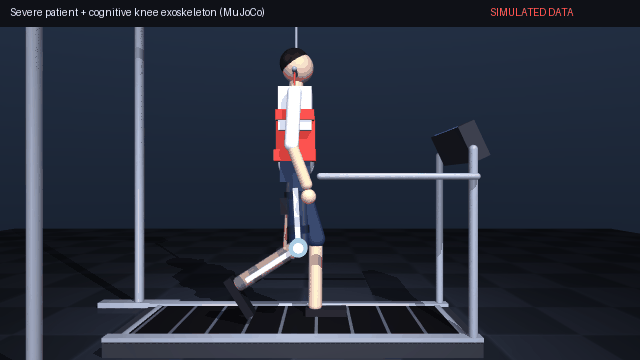
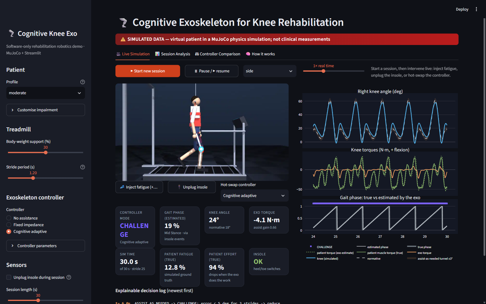
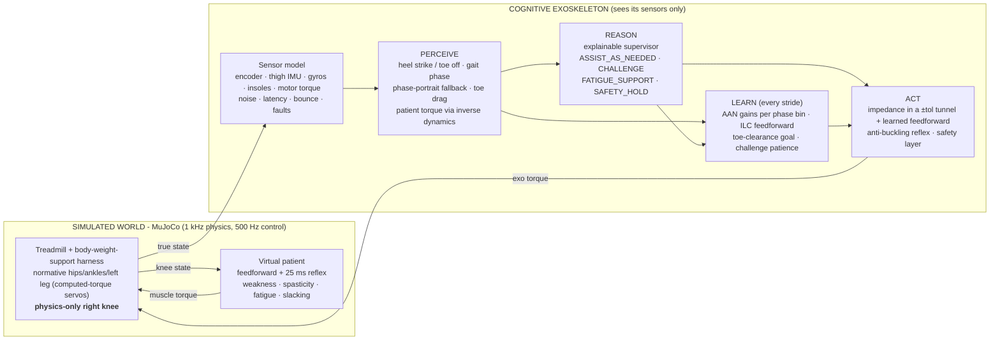
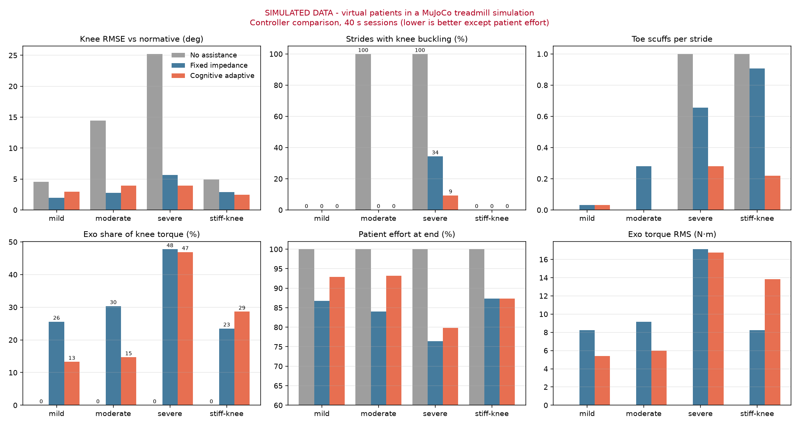
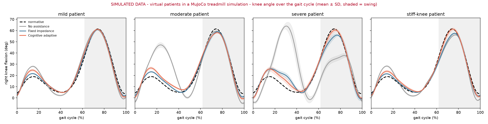
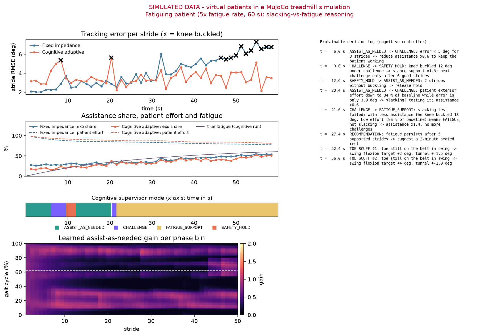

# 🦿 Cognitive Exoskeleton for Knee Rehabilitation

> **All results in this repository are SIMULATED.** A virtual patient walks on a treadmill in the
> MuJoCo physics engine. Nothing has been measured on a human, and nothing here is clinical evidence.

A software-only Cognitive Robotics project: a powered **knee exoskeleton** helps a person with a walking
disability (weak quadriceps, spasticity, fatigue) during **treadmill gait rehabilitation**.
The exoskeleton runs a full cognitive loop, **Perceive → Reason → Act → Learn**:

- It **perceives** the gait from noisy wearable sensors: heel strike, gait phase, sub-phase, toe drag, and the patient's own muscle torque.
- It **reasons** about the patient with an explainable supervisor. One of its rules tells *slacking* apart from *fatigue*.
- It **acts** with assist-as-needed impedance control inside a safety layer.
- It **learns** from stride to stride: gains per gait phase, a feedforward torque profile, and a toe-clearance goal.



| No assistance vs cognitive exoskeleton (severe patient) | Live dashboard |
|---|---|
| [`results/demo_comparison.mp4`](results/demo_comparison.mp4) |  |

---

## 1. Quick start (about 5 minutes)

```bash
# Python 3.10+ (tested with 3.12 on Windows 11)
python -m venv .venv
.venv\Scripts\activate            # macOS/Linux: source .venv/bin/activate
pip install -r requirements.txt

streamlit run app.py              # interactive dashboard -> http://localhost:8501
python scripts/live_viewer.py     # native interactive MuJoCo 3D viewer
```

Optional, to regenerate every figure and number in this README:

```bash
python scripts/run_experiments.py   # 16 sessions in parallel, about 1 min -> results/experiments_*
python scripts/check_perception.py  # perception accuracy vs ground truth -> results/perception*
python scripts/run_baseline.py      # unassisted patients -> results/baseline_*
python scripts/make_demo_media.py   # demo GIF + side-by-side MP4
python -m pytest tests              # 35 tests, about 2.5 min
```

> **Windows + Anaconda note:** `import exo` preloads the system `msvcp140.dll` before MuJoCo loads,
> because Anaconda ships an older MSVC runtime that makes `import mujoco` fail with *WinError 1114*.
> Always import `exo` before `mujoco`; every script here already does.

---

## 2. Demo instructions (suggested 5-minute walkthrough for the faculty)

1. **`streamlit run app.py` → Live Simulation.** Keep the defaults: *moderate* patient, *Cognitive adaptive* controller.
   - Press **▶ Start new session**.
   - You see the MuJoCo render, the knee angle vs normative gait (with the ±3° assist-as-needed tunnel), the exo and patient torques, and the true vs estimated gait phase.
   - Mode tiles and the explainable decision log update live.
2. **Intervene live:**
   - **💤 Inject fatigue.** Watch the supervisor switch to `FATIGUE_SUPPORT`; the decision log explains why.
   - **🔌 Unplug insole.** Perception falls back to the *thigh phase portrait*, and the Insole tile turns red.
   - **Hot-swap controller** to *No assistance*: the knee starts **buckling** in stance.
3. **Session Analysis:**
   - Press **⚡ Run headless session**. It runs 30 s in about 3 s.
   - Show the **rotatable 3D replay**, the learned gain heat-map (assistance concentrates where the patient needs it), and the perception check against ground truth.
   - Tick *Render MP4* for a video.
4. **Controller Comparison:** choose *severe* and then *fatiguing patient*.
   - The cognitive controller cuts buckling and toe scuffs.
   - For mild and moderate patients it uses **about half the assistance** of fixed impedance.
5. **How it works:** the architecture diagram, the equations and the honest limitations.
6. **Optional:** `python scripts/live_viewer.py` gives a native 3D viewer with mouse orbit. Keys:
   - `1`/`2`/`3` switch the controller (none / fixed / cognitive)
   - `4` injects fatigue
   - `5` unplugs the insole.

---

## 3. Architecture



**Key design decision.** Fully dynamic biped walking takes weeks to tune. We use the real clinical setup instead, a
**treadmill with body-weight support (Lokomat-style)**:
- The pelvis hangs in a harness.
- The hips, ankles and healthy left leg follow **normative gait data** through computed-torque servos.
- The **impaired right knee is driven only by physics**: patient muscle torque, exoskeleton motor torque, and a body-weight load that makes a weak knee **buckle**.

This makes the simulation fast (**~40× real time** for the bare world, 5–8× with the full stack), stable and reproducible.

### Reused models and data (nothing invented from scratch)

| What | Source |
|---|---|
| Physics, rendering, viewer, inverse dynamics | **MuJoCo 3** (`mj_step`, `mj_inverse`, `Renderer`, `viewer`) |
| Segment lengths and masses | **Winter's** anthropometric tables (1.75 m, 70 kg) |
| Normative hip/knee/ankle angles, gait events, sub-phases | **Winter (2009)**, **Perry & Burnfield (2010)**, smoothed as Fourier series |
| Muscle fatigue | simplified 3-compartment model, **Xia & Frey Law (2008)** |
| Slacking | **Reinkensmeyer** / Emken et al. slacking hypothesis |
| Assist-as-needed | error-based adaptation with forgetting, **Emken et al. (2007)** |
| Iterative learning control | **Arimoto**-type ILC |
| Phase estimation fallback | thigh phase portrait, **Quintero et al. (2018)** |
| Dashboard, plots | Streamlit, Plotly, Matplotlib |

### Code map

```
exo/
  __init__.py      Windows MSVC-runtime preload (import before mujoco)
  config.py        SimConfig, GaitConfig, SensorConfig, PatientConfig (+5 presets), ControllerConfig
  model/knee_exo.xml  MJCF: treadmill, harness, Winter body, right-knee exoskeleton, cameras
  gait.py          normative gait reference (Fourier curves + lookup tables), Perry sub-phases
  sim.py           MuJoCo wrapper: computed-torque servos, weight-sharing pelvis, insoles, rendering (GL thread)
  patient.py       virtual patient: weakness, spasticity, fatigue, slacking, delayed reflex, stance load
  perception.py    SensorModel (noise/latency/bounce/faults) + Perception (events, phase, torque)
  controllers.py   NoExo, FixedImpedance, CognitiveAdaptive (AAN + ILC + supervisor + reflex) + safety layer
  session.py       closed loop world -> sensors -> perception -> controller, logging, live hooks
  metrics.py       clinical-style gait metrics and perception accuracy
  viz.py           Plotly 3D skeleton animation, MP4 export
app.py             Streamlit dashboard (Live / Session Analysis / Controller Comparison / How it works)
scripts/           check_model, run_baseline, check_perception, run_experiments, make_demo_media, live_viewer
tests/             35 pytest tests (world, patient+session, perception, controllers, dashboard)
results/           all figures and tables (SIMULATED)
```

---

## 4. The virtual patient

The healthy nervous system is modelled as **feedforward** (the inverse dynamics of normative gait, minus the expected load)
plus **feedback** (intrinsic muscle impedance and a stretch reflex delayed by 25 ms). The impairments:

| Impairment | Model | Visible effect |
|---|---|---|
| Weakness | torque capacity = strength × (1 − fatigue) × 120 N·m; reduced neural gain; flexors at 60 % | the knee **buckles** in stance under body weight |
| Spasticity | rectus-femoris hyperreflexia, velocity-dependent, active only from pre-swing to mid-swing | **stiff-knee gait**, toe scuffing |
| Fatigue | rises with relative effort, recovers slowly | the patient gets weaker during the session |
| Slacking | effort falls when the exo carries the load (3 s adaptation) | why always assisting fully is bad for rehab |
| Body-weight load | 0.30 m × (1 − BWS) × body weight × weight share × sin(knee); the harness catches a collapse | buckling feedback |

Profiles: `healthy`, `mild`, `moderate`, `severe`, and `stiff-knee` (strong muscles but high spasticity, so only the swing phase is affected).
Every parameter can be changed with the dashboard sliders.

**Unassisted baseline (SIMULATED,** `results/baseline_knee_curves.png`**):**

| Profile | Knee RMSE vs normative | Peak swing flexion (normal 61°) | Strides with buckling |
|---|---|---|---|
| healthy | 3.8° | 62.8° | 0 % |
| moderate | 14.2° | 59.5° | 100 % |
| severe | 24.8° | 38.3° | 100 % |
| stiff-knee | 4.9° | 56.2° (a toe scuff every stride) | 0 % |

---

## 5. Perception: the exoskeleton never sees ground truth

Controllers receive only a `Percept` built from simulated **wearable sensors** with realistic flaws:
- a 14-bit knee encoder
- a thigh IMU with 1° mounting bias and 0.5° noise
- thigh and shank gyros
- heel and toe insole switches with **15 ms latency, 6 ms contact bounce and random vibration pulses**
- noisy motor torque
- an optional **insole disconnection** fault.

| Estimate | Method |
|---|---|
| Heel strike / toe off | debounced switches with a refractory window. The detection is time-stamped back by the known delay. Swing-phase toe drags are rejected as toe-offs. |
| Gait phase | time since heel strike ÷ adaptive stride period (median of the last 3). Stride periods vary by 2 % in the simulation. |
| Fallback phase | **self-calibrating thigh phase portrait**: phase = polar angle of (thigh angle, −thigh velocity). A 50-bin correction table is learned online while the insoles work, and a forward-only tracker smooths it. It takes over automatically when a heel strike is overdue. |
| Sub-phase, stance | Perry's 7 sub-phases. Stance runs from heel strike to the detected toe off. |
| Toe drag | the toe switch is still closed after toe off is due (latency-compensated) |
| Patient muscle torque | `mj_inverse` on the measured thigh/knee motion − measured exo torque − modelled body-weight load. It is held while the knee is at the hyperextension stop. |

**Accuracy vs simulator ground truth** (`results/perception.png`, SIMULATED):
- Gait phase error is **1.0 % of the cycle** with the insoles and **1.9 %** on the phase-portrait fallback after the insole is unplugged.
- **100 %** of heel strikes are detected, with **0** false detections despite bounce and false pulses, and a timing error of about **6 ms**.
- The patient torque estimate correlates with the truth at **r = 0.96** (moderate patient; 0.90 for the severe patient).

---

## 6. Controllers

All controllers use the same **safety layer**: a ±60 N·m torque limit, a 2000 N·m/s slew limit, no pushing into hyperextension, and a torque cut on overspeed.
The reference is the **normative knee angle at the estimated phase and cadence**.

**Fixed impedance (conventional baseline):**
`τ = K(θ_ref − θ) + B(θ̇_ref − θ̇)`, with K = 120 N·m/rad (×1.5 in stance) and B = 6 N·m·s/rad.

**Cognitive adaptive (this project):**

```
τ_exo = sat( g[b]·s_mode·[ K·dead(θ* − θ, tol[b]) + B·ė ] + s_mode·u_ff[b] ),   b = bin of the estimated phase (50 bins)

per stride:   g[b]    ← 0.9·g[b]    + 2·|dead(ē[b])|        (assist-as-needed, Emken 2007)
              u_ff[b] ← 0.9·u_ff[b] + 40·dead(ē[b+1])       (iterative learning, phase-advanced)
```

| Component | Role |
|---|---|
| **±3° tunnel** (`dead`) | no corrective torque while the knee stays close enough to the target, so the patient keeps doing the work |
| **AAN gains per phase bin** | assistance grows where the patient fails and is *forgotten* where they cope |
| **ILC feedforward** | learns the anticipatory torque the patient lacks, stride after stride |
| **Goal adaptation** | a perceived toe drag raises the early-swing flexion target `θ* = θ_ref + Δ_clear` (+2° per scuff, slow decay). The goal is functional (clear the toe), not just tracking. |
| **Anti-buckling reflex** | stance excess above 12° makes the stance stiffness at least ×2 within the same stride |
| **Explainable supervisor** | runs once per stride with hysteresis; every transition is logged with its reason (table below) |

| Mode | Scale `s_mode` | Entered when |
|---|---|---|
| `ASSIST_AS_NEEDED` | ×1.0 | default |
| `CHALLENGE` | ×0.6 (ILC paused) | N good strides in a row, **or** patient effort drops while the error stays low (slacking suspected) |
| `FATIGUE_SUPPORT` | ×1.4 | effort is low and the error is high, **or a slacking test failed**. It also recommends a rest. |
| `SAFETY_HOLD` | ×1.3 | the knee buckled more than 12° |

**The supervisor's key behaviours:**
- **Hypothesis testing.** Low effort with low error is ambiguous: the patient could be slacking or fatigued. The supervisor *tests* the slacking hypothesis by reducing assistance. If the knee then fails, it concludes **fatigue, not slacking** and supports the patient instead.
- **Learned patience.** Every failed challenge doubles the number of good strides required before the next one.

Example decision log (SIMULATED, `results/cognitive_decision_logs.txt`):
```
t= 20.4 s  ASSIST_AS_NEEDED -> CHALLENGE: patient extensor effort down to 84 % of baseline while error is only 3.0 deg -> slacking? testing it
t= 21.6 s  CHALLENGE -> FATIGUE_SUPPORT: slacking test failed: with less assistance the knee buckled 13 deg. Low effort means FATIGUE, not slacking
t= 27.4 s  RECOMMENDATION: fatigue persists after 5 supported strides -> suggest a 2-minute seated rest
```

---

## 7. Results (SIMULATED)

`python scripts/run_experiments.py` runs 40 s sessions with the same virtual patients and the same simulator for all three controllers.

| Patient | Controller | Knee RMSE | Buckling strides | Toe scuffs / stride | Exo share of torque | Patient effort at end |
|---|---|---|---|---|---|---|
| mild | fixed / **cognitive** | 1.9° / 3.0° | 0 / 0 % | 0 / 0 | 26 % / **13 %** | 87 % / **93 %** |
| moderate | none / fixed / **cognitive** | 14.4° / 2.8° / 3.9° | 100 / 0 / 0 % | 0 / 0.3 / **0** | – / 30 % / **15 %** | 100 / 84 / **93 %** |
| severe | none / fixed / **cognitive** | 25.2° / 5.7° / **3.9°** | 100 / 34 / **9 %** | 1.0 / 0.7 / **0.3** | – / 48 % / 47 % | 100 / 76 / 80 % |
| stiff-knee | none / fixed / **cognitive** | 4.9° / 2.9° / **2.5°** | 0 % | 1.0 / 0.9 / **0.2** | – / 23 % / 29 % | 100 / 87 / 87 % |
| fatiguing moderate (60 s, 5× fatigue) | fixed / **cognitive** | 4.1° / **3.5°** | 22 / **4 %** | 0.3 / 0.1 | 39 % / 34 % | 77 / 81 % |
| moderate, insole unplugged at 20 s | cognitive | 3.9° | 3 % | 0 | 19 % | 90 % |

What the results show:
- **Mild and moderate patients:** the cognitive controller deliberately allows ±3°, so its RMSE is slightly higher. It uses **half the assistance**, and the patient keeps **more of their own effort** (less slacking), which is the aim of assist-as-needed rehabilitation.
- **Severe and stiff-knee patients:** it is **safer and more functional**. Buckling falls from 34 % to 9 % and toe scuffs from 0.9 to 0.2 per stride, at similar assistance.
- **Fatiguing patient:** it detects fatigue and switches to support, so buckling falls from 22 % to 4 %.





---

## 8. Testing

```
python -m pytest tests     # 35 passed
```
The tests cover:
- the world model (periodicity, foot-flat, insole timing, rendering)
- patient pathology ordering, and the session loop (incremental advance gives the same result as a full run)
- sensor latency, faults and debouncing
- phase error under 5 % and heel-strike detection
- the phase-portrait fallback and torque-estimate accuracy
- the safety-layer limits
- AAN (less assistance, more patient effort), severe-patient safety, decision logging, and fatigue-vs-slacking reasoning
- the dashboard (Streamlit AppTest runs a headless session) and the 3D/MP4 export.

## 9. Limitations (please read)

- **Model scope:** sagittal plane only. Hips and ankles are driven kinematically, and the pelvis height is kinematic. Only the right knee is fully dynamic.
- **Sensors:** insole switches are emulated from gait events plus a physics-based toe-scuff check.
- **Patient model:** a literature-parameterised model, not fitted to any real person. Fatigue is a simplified model.
- **Validation:** controller gains were tuned in simulation. No hardware, no human data, no clinical validation.

**All numbers are simulation outputs.**

## 10. References

- Todorov, Erez & Tassa (2012). MuJoCo: a physics engine for model-based control. *IROS*.
- Winter (2009). *Biomechanics and Motor Control of Human Movement*, 4th ed.
- Perry & Burnfield (2010). *Gait Analysis: Normal and Pathological Function*, 2nd ed.
- Emken, Bobrow & Reinkensmeyer (2007). Robotic movement training as an optimization problem: designing a controller that assists only as needed. *ICORR*.
- Reinkensmeyer et al. (2009). Slacking by the human motor system: computational models and implications for robotic orthoses. *IEEE EMBC*.
- Xia & Frey Law (2008). A theoretical approach for modeling peripheral muscle fatigue and recovery. *J. Biomech.*
- Quintero, Villarreal, Lambert, Kapp & Gregg (2018). Continuous-phase control of a powered knee–ankle prosthesis. *IEEE T-RO.*
- Arimoto, Kawamura & Miyazaki (1984). Bettering operation of robots by learning. *J. Robotic Systems.*
- Banala, Kim, Agrawal & Scholz (2009). Robot assisted gait training with active leg exoskeleton (ALEX). *IEEE TNSRE.*
- Marchal-Crespo & Reinkensmeyer (2009). Review of control strategies for robotic movement training after neurologic injury. *J. NeuroEng. Rehabil.*
